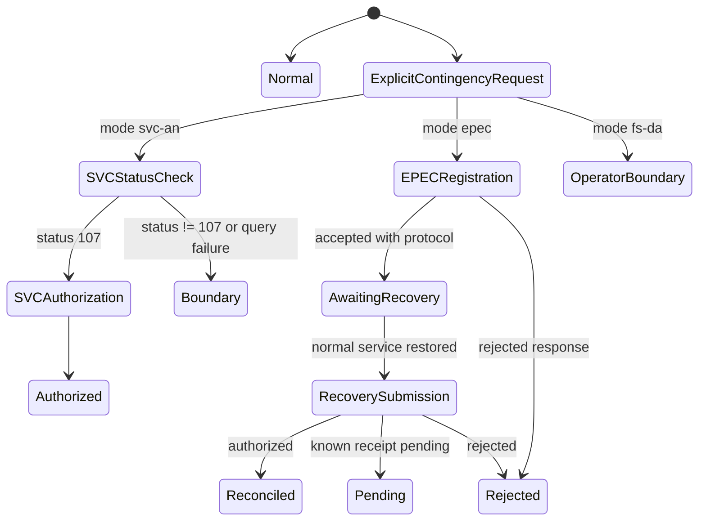

# Data Model: NF-e SP Production Contingency

## Execution Mode

- **Purpose**: Distinguish normal authorization from every contingency mode represented by the public outcome.
- **Values**: `normal`, `svc-an`, `epec`, `fs-da`.
- **Validation rules**:
  - The issuer must resolve consistently to SP (`cUF` `35`) for this feature.
  - `normal` preserves the current authorization behavior.
  - A contingency mode is selected explicitly; it is never inferred as an automatic fallback from timeout or unavailability.
  - `fs-da` remains an unsupported or operator-assisted boundary unless current state-level applicability is established.

## Contingency Attempt

- **Purpose**: Describe a single explicit request to issue a production NF-e using a selected contingency mode.
- **Fields**:
  - `mode`: `svc-an`, `epec`, or `fs-da`.
  - `issuerUF`: validated UF code, `35` for this slice.
  - `environment`: `production`.
  - `documentKey`: 44-digit access key for the NF-e associated with the attempt.
  - `tpEmis`: `6` for SVC-AN, `4` for EPEC, or `5` for FS-DA.
  - `startedAt` and `reason`: operator-supplied contingency context included in the NF-e when required by the schema.
  - `activationEvidence`: SVC status observation when mode is `svc-an`.
  - `eventProtocol`: accepted EPEC protocol when mode is `epec`.
  - `state`: current outcome state and a `nextAction` when one is required.
- **Validation rules**:
  - SVC-AN authorization proceeds only after a production SVC status query returns `107`.
  - Status `113`, `114`, missing/unknown status, or transport failure does not permit authorization through SVC.
  - SVC authorization uses the SVC-AN provider and `tpEmis=6`; EPEC registration uses the Ambiente Nacional event route and `tpEmis=4` on the matching NF-e.
  - A normal submission with uncertain acceptance cannot silently be resent through a contingency route. When required by the MOC, a distinct NF-e number/access key is required for the contingency document.
  - The full NF-e transmitted after EPEC recovery must retain the access key associated with the accepted EPEC.

## EPEC Event Details

- **Purpose**: Supply the fiscal facts serialized into the existing `detEvento` schema for event `110140`; production must not inherit simplified homologation assumptions.
- **Required values**:
  - `environment`: `production` or `homologation`, mapped to event `tpAmb` `1` or `2`; existing callers retain homologation as the default.
  - `documentKey`, `issuerCNPJ`, and `issuerUF`: the 44-digit NF-e key, issuer identifier, and issuer UF; the key's `cUF` must agree with the issuer UF and request context.
  - `issuerIE`: issuer state registration matching the XSD pattern of 2-14 digits; do not substitute `ISENTO`.
  - `emissionDateTime`: NF-e emission timestamp in the schema's date-time format with timezone.
  - `tpNF`: `0` for entry or `1` for exit; do not assume exit.
  - `recipientUF`: recipient UF, including `EX` for a foreign destination; do not infer it from the issuer UF.
  - `recipientDocument`: exactly one recipient identity encoded as CNPJ, CPF, or `idEstrangeiro`, according to the existing event XSD.
  - `recipientIE`: optional recipient state registration, emitted only when supplied and applicable.
  - `totalValue`, `totalICMS`, and `totalICMSST`: caller-supplied NF-e totals serialized as `vNF`, `vICMS`, and `vST` using the schema's `TDec_1302` lexical format.
- **Fixed event values**: `descEvento=EPEC`, `tpAutor=1` (issuer), and event code `110140`, as defined by the checked-in EPEC schema.
- **Validation rules**:
  - Validate required identity, UF, date-time, enum, IE, and decimal fields before transport.
  - Never hardcode invoice direction, issuer IE, recipient UF, ICMS, or ICMS-ST totals for production.
  - Keep the event's document key identical to the key supplied for later EPEC recovery.
- **Schema reference**: `xsd/Evento_EPEC_PL_v1.01/e110140_v1.00.xsd` and `xsd/Evento_EPEC_PL_v1.01/leiauteEPEC_v1.00.xsd`.

## SVC Activation Observation

- **Purpose**: Capture the official activation status used to gate an explicit SVC-AN attempt.
- **Fields**:
  - `provider`: `SVCAN`.
  - `environment`: `production`.
  - `statusCode`: `107`, `113`, or `114`, or an unrecognized/missing value retained as inconclusive evidence.
  - `observedAt`: local observation time.
- **State mapping**:
  - `107`: active; authorization may proceed for the explicitly selected SVC-AN mode.
  - `113`: deactivation pending; do not authorize through SVC.
  - `114`: disabled by the source UF; do not authorize through SVC.
  - Transport error or any other response: unavailable or inconclusive; do not authorize through SVC.
- **Ownership**: The activation state is transient and must not be cached as current beyond the one attempted authorization.

## Contingency Recovery Record

- **Purpose**: Correlate the original document and selected mode with a later transmission or result after normal service recovers.
- **Fields**:
  - `documentKey`: original contingency document key.
  - `mode`: `svc-an`, `epec`, or `fs-da`.
  - `eventProtocol`: EPEC protocol when applicable.
  - `reconciliationDeadlineDays`: the SP seven-day EPEC reconciliation period, returned as guidance after accepted production registration.
  - `receiptNumber`: known `nRec` when a later NF-e submission is asynchronous.
  - `attemptOutcome`: initial contingency state and its protocol/receipt evidence.
  - `recoveryOutcome`: `pending`, `reconciled`, `rejected`, `unavailable`, or `inconclusive`.
  - `nextAction`: explicit caller action; never an automatic retry loop.
  - `executionMode`, `contingencyState`, `recoveryContext`, and `recoveryState`: additive result metadata that keeps the original classification unchanged.
- **Validation rules**:
  - SVC-authorized NF-e is not retransmitted to the origin UF after recovery.
  - EPEC and supported FS-DA documents require later submission to the origin UF within applicable legal deadlines.
  - EPEC recovery must use the matching access key; an EPEC without its corresponding NF-e remains pending and can block new EPEC registrations in SP after seven days.
  - The SDK remains stateless. The integrator owns durable storage and supplies prior contingency context for recovery.
  - When reconciling a known `receiptNumber`, the caller may supply the contingency mode, document key, and EPEC protocol as recovery context; the SDK returns that context without changing the existing receipt classification.
  - A terminal receipt whose returned document key conflicts with the caller's recovery key cannot be considered reconciled; project the recovery state as `inconclusive`.

## Outcome State

- `activation-verified`: SVC status returned `107` before SVC authorization.
- `event-registered`: EPEC was accepted and has a protocol; it is not an NF-e authorization.
- `authorized`: the chosen mode returned an NF-e authorization.
- `awaiting-recovery`: accepted EPEC or assisted issuance still requires a later action.
- `pending`: an explicit known-receipt or recovery query has no terminal result yet.
- `reconciled`: required post-recovery NF-e authorization is confirmed.
- `rejected`: the fiscal authority rejected the event or NF-e.
- `unavailable`: a requested service could not be reached.
- `inconclusive`: response evidence does not prove a terminal state.
- `operator-assisted`: physical or manual action is required and is not performed by the SDK.
- `unsupported`: the UF/mode combination is outside the verified runtime scope.

Normal authorization remains represented by `executionMode: normal` with existing classifications. The existing authorization classification meanings are not repurposed.

## State Relationship

