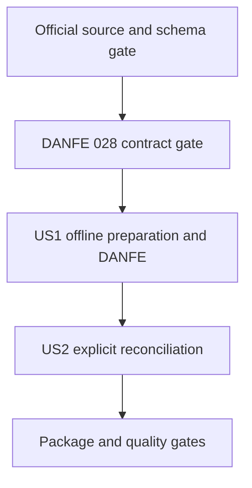

# Tasks: NFC-e SP Offline Contingency

**Input**: Design documents from `/specs/029-nfce-sp-offline/`

**Prerequisites**: `plan.md`, `spec.md`, `research.md`, `data-model.md`, `contracts/`, and `quickstart.md`

**Tests**: Required by CC-004 and the package contract: use Jest fixtures and injected transport; never call live production services.

## Phase 1: Setup

**Purpose**: Project initialization

No setup tasks are required. The existing ESM package, NFC-e module tree, and Jest tooling will be reused.

## Phase 2: Foundational

**Purpose**: Close normative and ownership gates that block implementation of both user stories.

- [x] T001 Reconfirm the current consolidated Ajuste SINIEF 19/2016 clause 11, Manual Offline NFC-e v2.0, MOC Annex IV, DANFE manual v6.0, and the applicable NFC-e schema; record confirmed fields, deadlines, QR payload, duplicate/sequence boundaries, and source dates in `research.md`.
- [x] T002 Resolve DANFE ownership by updating feature 028's spec, plan, and public contract for signed offline XML, pending notice, no authorization protocol, and QR v2; record the decision in the feature 029 public contract.

**Checkpoint**: Do not begin story implementation until the confirmed source rules and the feature 028 rendering contract cover offline DANFE without implying authorization.

## Phase 3: User Story 1 - Issue during loss of connectivity (Priority: P1) - MVP

**Goal**: Prepare an eligible SP NFC-e offline, identify it as pending, and provide the required auxiliary representation without claiming authorization.

**Independent Test**: With local fixtures, verify an eligible `tpEmis=9` document produces a retained signed XML and pending status, no transport occurs during preparation, the supported DANFE identifies contingency, and unsupported conditions return a clear boundary. Do not use live production transmission.

### Tests for User Story 1

- [x] T003 [P] [US1] Add unit and public-contract tests for offline preparation, pending status, no transport outcome, offline QR v2 payload, deadline boundary, and unsupported/missing prerequisites in `tests/unit/nfce/prepare-nfce-sp-offline.test.ts` and `tests/contract/nfce-sp-offline-preparation.test.ts`.
- [x] T004 [P] [US1] Add a shared preparation-input fixture and journey test for valid SP production `tpEmis=9`, identity mismatch, invalid environment, and expired deadline in `tests/fixtures/nfce/offline/build-nfce-sp-offline-preparation-input.ts` and `tests/integration/nfce/prepare-nfce-sp-offline.test.ts`.
- [x] T005 [P] [US1] Add renderer tests for a pending offline record, required contingency indication, QR v2 URL, and absence of an authorization protocol claim in `tests/unit/nfce/render-nfce-sp-danfe.test.ts` and `tests/integration/nfce/render-nfce-sp-danfe.test.ts`.

### Implementation for User Story 1

- [x] T006 [US1] Finalize the verified offline-record fields, pending status, and preparation contract in `specs/029-nfce-sp-offline/data-model.md`, `specs/029-nfce-sp-offline/contracts/public-nfce-sp-offline.md`, and `src/canonical/nfce/contracts.ts`.
- [x] T007 [US1] Implement local eligibility/XML validation and signing that returns the immutable signed XML, access key, digest, and `pending-reconciliation` status without transport in `src/canonical/nfce/prepare-nfce-sp-offline.ts`.
- [x] T008 [US1] Export the offline preparation function and types through `src/canonical/nfce/index.ts`, `src/canonical/index.ts`, and `src/index.ts` while preserving existing `authorizeNFCe` outcomes.
- [x] T009 [US1] Extend the feature 028 renderer to accept the approved offline input and render its pending state without requiring authorization-response evidence in `src/canonical/nfce/render-nfce-sp-danfe.ts` and `src/canonical/nfce/contracts.ts`.
- [x] T010 [US1] Document preparation prerequisites, returned record fields, and offline DANFE behavior in `src/canonical/nfce/prepare-nfce-sp-offline.doc.md`, `src/canonical/nfce/render-nfce-sp-danfe.doc.md`, and `README.md`.

**Checkpoint**: User Story 1 is complete when the offline flow is locally testable, non-authorizing, bounded by verified rules, and its pending DANFE contract works independently of reconciliation.

## Phase 4: User Story 2 - Reconcile an offline document after recovery (Priority: P2)

**Goal**: Submit one retained offline document on explicit request and associate the authority's response or required operator action with the original record.

**Independent Test**: Provide a retained US1 record and deterministic transport fixtures for authorization, receipt, rejection, unavailable, timeout, duplicate, identity mismatch, and inconclusive responses; verify distinct outcomes, unchanged document association, and no silent duplicate success.

### Tests for User Story 2

- [x] T011 [P] [US2] Add unit and public-contract tests for each reconciliation status, response correlation, receipt-versus-authorization distinction, exactly one transport attempt per call, and duplicate/ambiguous operator-action cases in `tests/unit/nfce/reconcile-nfce-sp-offline.test.ts` and `tests/contract/nfce-sp-offline-reconciliation.test.ts`.
- [x] T012 [P] [US2] Add deterministic recovery fixtures and integration tests for caller-initiated retry, duplicate response, timeout, and preservation of the original access key/XML digest in `tests/fixtures/nfce/offline/reconciliation-responses.json` and `tests/integration/nfce/reconcile-nfce-sp-offline.test.ts`.

### Implementation for User Story 2

- [x] T013 [US2] Implement one explicit reconciliation attempt using the retained signed XML and injected request executor, preserving transport/official response evidence and mapping only correlated authorization to `authorized` in `src/canonical/nfce/reconcile-nfce-sp-offline.ts`.
- [x] T014 [US2] Export the reconciliation function and result types through `src/canonical/nfce/index.ts`, `src/canonical/index.ts`, and `src/index.ts` without changing the existing authorization contract.
- [x] T015 [US2] Document caller-owned persistence, deadline-aware retry, duplicate/ambiguous outcomes, and operator actions in `src/canonical/nfce/reconcile-nfce-sp-offline.doc.md`, `src/canonical/nfce/contracts.doc.md`, and `README.md`.

**Checkpoint**: User Story 2 is complete when every explicit attempt yields a correlated, distinct outcome and unresolved records remain visible to the caller.

## Phase 5: Polish and Cross-Cutting Concerns

**Purpose**: Close package compatibility and quality gates across both stories.

- [x] T016 Update the public API inventory and package-contract coverage for both offline operations in `src/public-contract.ts`, `tests/contract/root-entrypoint.test.ts`, `tests/contract/public-nfce-operational-facade.test.ts`, and `tests/integration/package-tarball-smoke.test.ts`.
- [x] T017 Run the focused and full validation commands in `specs/029-nfce-sp-offline/quickstart.md`, including Jest, ESLint, Prettier, typecheck, build, public-contract audit, tarball validation, and docs-link validation; fix any feature-caused failures in their owning files.

## Dependencies and Execution Order

### Phase Dependencies

- **Setup (Phase 1)**: No work; repository infrastructure already exists.
- **Foundational (Phase 2)**: T001 precedes T002; both block story implementation.
- **User Story 1 (Phase 3)**: Starts after Phase 2. This is the MVP and owns the shared offline-record model.
- **User Story 2 (Phase 4)**: Starts after US1 defines and exports the offline record contract; reconciliation consumes that record.
- **Polish (Phase 5)**: Depends on both stories.

### Dependency Graph



### Parallel Opportunities

- After Phase 2, US1 test tasks T003, T004, and T005 can run in parallel because they target distinct test/fixture files.
- After US1, US2 test tasks T011 and T012 can run in parallel because they target distinct test/fixture files.
- Do not parallelize US1 and US2 implementation: US2 consumes the offline-record contract created by US1.

## Parallel Example: User Story 1

```text
Task: T003 unit and public-contract preparation tests
Task: T004 offline XML fixtures and preparation integration tests
Task: T005 offline DANFE renderer tests
```

## Parallel Example: User Story 2

```text
Task: T011 reconciliation outcome and contract tests
Task: T012 recovery, retry, and duplicate-response fixtures
```

## Implementation Strategy

### MVP First

1. Complete T001-T002 to close source and DANFE gates.
2. Complete US1 (T003-T010) and validate its pending/non-authorized state independently.
3. Stop at the US1 checkpoint for MVP; do not claim end-to-end offline operation until its DANFE is covered.

### Incremental Delivery

1. Deliver the offline preparation and pending DANFE behavior as US1.
2. Add explicit one-document reconciliation as US2, retaining unresolved outcomes for caller action.
3. Complete T016-T017 before release; assess the public API's semantic-version impact before publishing.

## Notes

- Every task has an ID, checkbox, applicable story label, and concrete path.
- `[P]` is used only for test/fixture tasks in distinct files with no dependency on another incomplete task.
- Requirements that remain unconfirmed in `research.md` must be resolved in T001 before code relies on them.
- No SDK persistence, background polling, automatic contingency switch, multi-document recovery, or new dependency is included.

## Phase 6: Convergence

- [x] T018 Require caller-provided business-calendar evidence to verify that `submissionDeadline` is the end of the first following business day; reject unverifiable or later future deadlines and cover both boundaries per FR-003.
- [x] T019 Reconcile the stale feature 029 plan and public contract that still mark the completed feature 028 offline DANFE integration as blocked or proposed per T002.
- [x] T020 Align the public reconciliation status vocabulary, runtime classifications, documentation, and tests while preserving duplicate and timeout detail per plan: public reconciliation contract.
