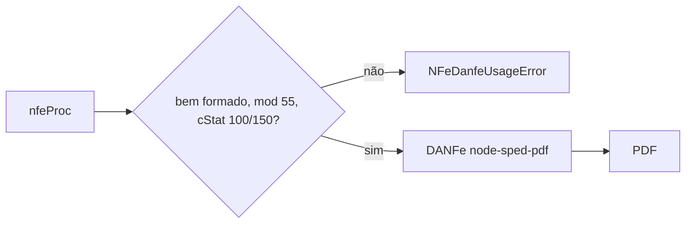

# renderNFeDANFE

## Visão geral

Gera o DANFE (PDF) de uma NF-e modelo 55 autorizada a partir do XML `nfeProc` exato (NFe assinada + `protNFe`), usando `node-sped-pdf`.

## Responsabilidades

- Recusar XML malformado, que não seja modelo 55 ou sem protocolo autorizado (`cStat` 100 ou 150) com `NFeDanfeUsageError`.
- Delegar o desenho ao `DANFe` de `node-sped-pdf` e devolver os bytes do PDF.

## Entradas e saídas

```ts
renderNFeDANFE({ authorizedXml: string }): Promise<Uint8Array>
class NFeDanfeUsageError extends Error
```

## Fluxo principal



## Tratamento de erros e casos-limite

Documentos denegados ou rejeitados não geram DANFE. O XML original não é alterado; nenhum dado é calculado ou corrigido.

## Exemplos

```ts
const pdf = await renderNFeDANFE({ authorizedXml });
```

## Dependências e integrações

`node-sped-pdf` (dependência com `canvas` nativo), `@xmldom/xmldom`. Usado pelo servidor via `FiscalGateway.renderDanfe`.
