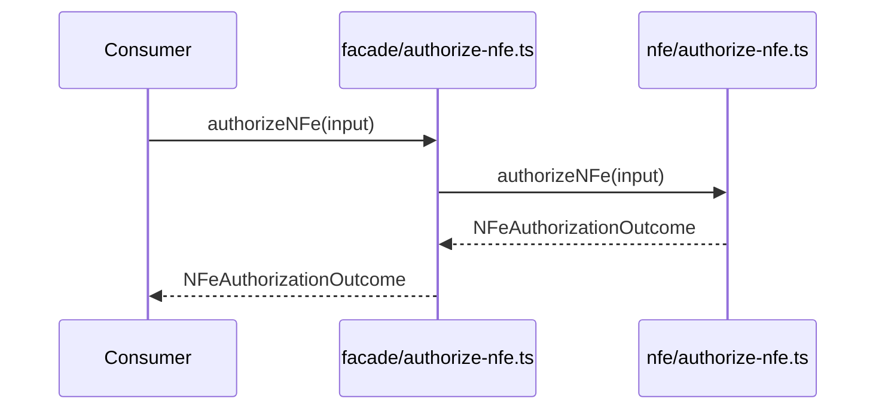

# src/canonical/facade/authorize-nfe.ts

## Visao geral

Expõe a autorizacao operacional de NFe como funcao additive da facade publica.

## Responsabilidades

- Receber o request estruturado do integrador.
- Delegar a orquestracao para a camada operacional.
- Manter a fronteira entre facade publica e implementacao interna.

## Entradas e saidas

- Entradas: `NFeAuthorizationRequest`.
- Saidas: `Promise<NFeAuthorizationOutcome>`.

## Fluxo principal



## Tratamento de erros e casos-limite

- O wrapper nao implementa validacoes adicionais.
- As validacoes de escopo e de uso ficam na camada operacional.

## Exemplos

```ts
import { authorizeNFe } from './authorize-nfe.js';
```

## Dependencias e integracoes

- `../nfe/authorize-nfe.js`
- `../nfe/contracts.js`