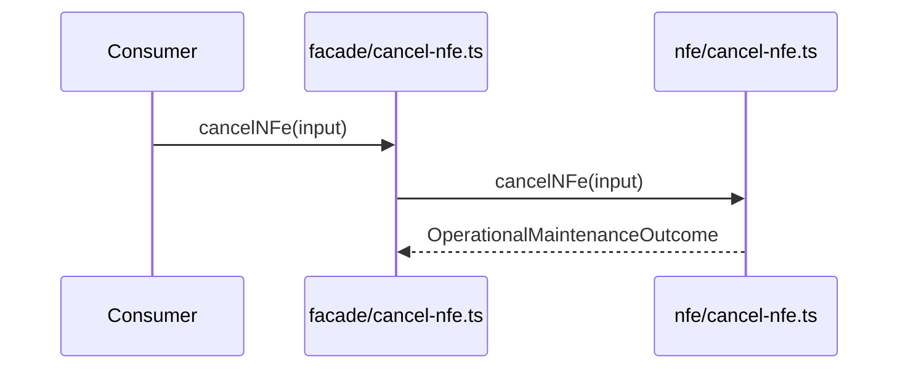

# src/canonical/facade/cancel-nfe.ts

## Visao geral

Publica o cancelamento homologado no barrel de facade manual.

## Responsabilidades

- Receber o input especifico do cancelamento.
- Delegar a chamada para `../nfe/cancel-nfe.js`.
- Preservar a fronteira entre facade publica e dominio operacional.

## Entradas e saidas

- Entradas: `OperationalMaintenanceFacadeInput`.
- Saidas: `Promise<OperationalMaintenanceOutcome>`.

## Fluxo principal



## Tratamento de erros e casos-limite

- O wrapper nao adiciona regras novas.

## Exemplos

```ts
import { cancelNFe } from './cancel-nfe.js';
```

## Dependencias e integracoes

- `../nfe/cancel-nfe.js`
- `../nfe/contracts.js`
- `../nfe/maintenance-outcome.js`
