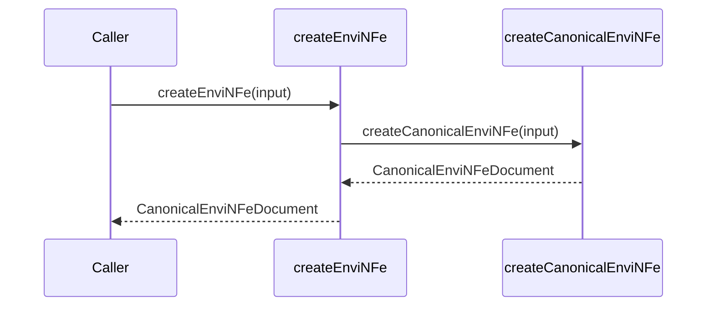

# src/canonical/facade/create-envi-nfe.ts

## Visao geral

Expõe a criacao publica de `enviNFe` no root import do pacote.

## Responsabilidades

- Receber a entrada canonica do lote.
- Delegar a criacao canonica de `enviNFe`.
- Preservar uma API publica pequena e previsivel.

## Entradas e saidas

- Entradas: `CanonicalEnviNFeInput`.
- Saidas: `CanonicalEnviNFeDocument`.

## API / Assinatura

```ts
export function createEnviNFe(
  input: CanonicalEnviNFeInput,
): CanonicalEnviNFeDocument;
```

## Fluxo principal



## Tratamento de erros e casos-limite

- Repassa erros de lote vazio e de validacao compartilhada.

## Exemplos

```ts
const batch = createEnviNFe({
  batchId: '1',
  documents: [{ documentId: 'NFe001', environment: 'homologation', version: '4.00' }],
  environment: 'homologation',
  version: '4.00',
});
```

## Dependencias e integracoes

- `../nfe/canonical-envi-nfe`
- `../shared/contracts`