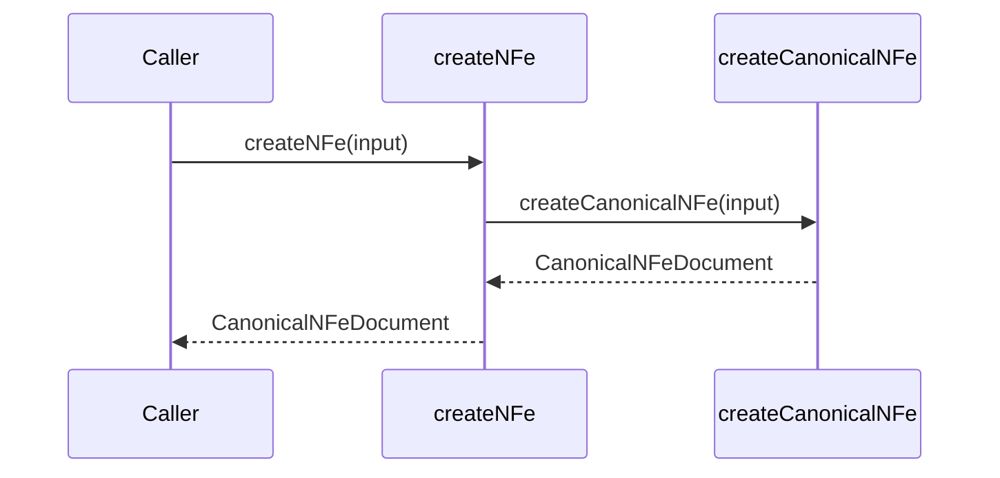

# src/canonical/facade/create-nfe.ts

## Visao geral

Expõe a criacao publica de `NFe` no root import do pacote.

## Responsabilidades

- Receber a entrada canonica da integracao.
- Delegar a criacao do documento canonico interno.
- Manter a API publica enxuta.

## Entradas e saidas

- Entradas: `CanonicalNFeInput`.
- Saidas: `CanonicalNFeDocument`.

## API / Assinatura

```ts
export function createNFe(input: CanonicalNFeInput): CanonicalNFeDocument;
```

## Fluxo principal



## Tratamento de erros e casos-limite

- Repassa os erros de validacao do criador canonico.

## Exemplos

```ts
const document = createNFe({
  documentId: 'NFe001',
  environment: 'homologation',
  version: '4.00',
});
```

## Dependencias e integracoes

- `../nfe/canonical-nfe`
- `../shared/contracts`