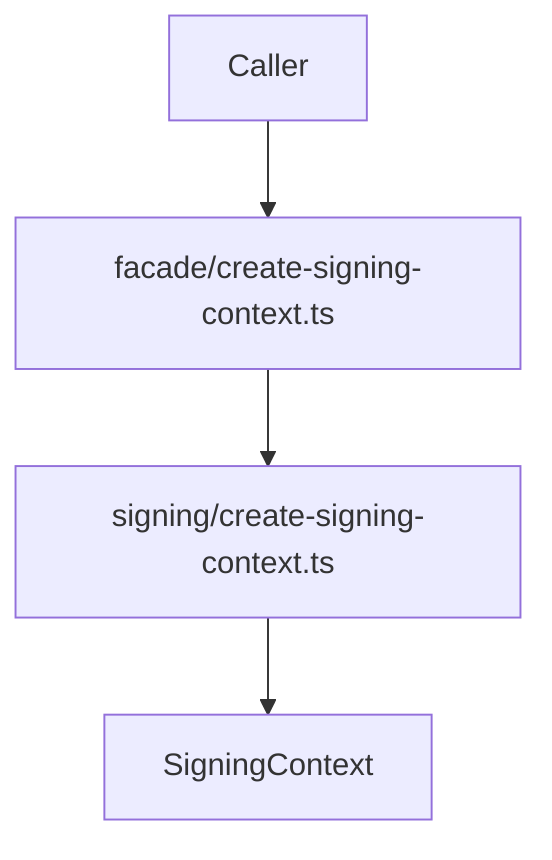

# src/canonical/facade/create-signing-context.ts

## Visao geral

Expoe no barrel canonico a operacao publica que prepara um `SigningContext` reutilizavel.

## Responsabilidades

- Receber o contrato publico de criacao do contexto.
- Delegar a extracao criptografica ao slice interno de assinatura.
- Preservar o root import como superficie publica principal.

## Entradas e saidas

- Entradas: `CreateSigningContextInput` com `source` e `passphrase`.
- Saidas: `Promise<SigningContext>`.

## Fluxo principal



## Tratamento de erros e casos-limite

- Nao implementa validacoes diretamente.
- Falhas de parsing PKCS#12 e de origem A1 sobem do slice interno.

## Exemplos

```ts
const signingContext = await createSigningContext(input);
```

## Dependencias e integracoes

- `../signing/contracts.js`
- `../signing/create-signing-context.js`