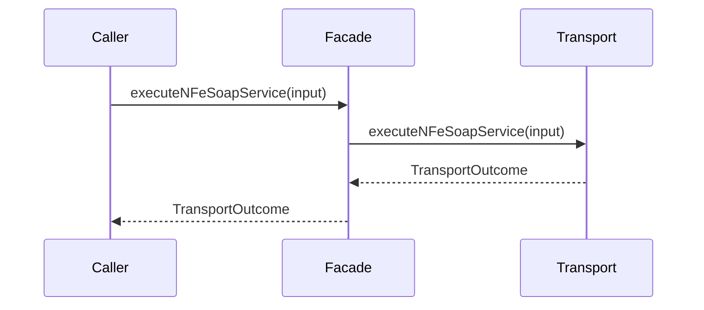

# src/canonical/facade/execute-nfe-soap-service.ts

## Visao geral

Expoe a execucao SOAP suportada como wrapper da fachada manual.

## Responsabilidades

- Receber a entrada publica do integrador.
- Delegar a execucao ao modulo interno de transporte.
- Manter o root contract desacoplado da implementacao interna.

## Entradas e saidas

- Entradas: `ExecuteNFeSoapServiceInput`.
- Saidas: `Promise<TransportOutcome>`.

## Fluxo principal



## Tratamento de erros e casos-limite

- Repassa os erros produzidos pela camada de transporte.

## Exemplos

```ts
await executeNFeSoapService({
  environment: 'homologation',
  payloadXml: '<xml />',
  service: 'nfe-status-service',
});
```

## Dependencias e integracoes

- `../transport/execute-nfe-soap-service.ts`
- `./index.ts`