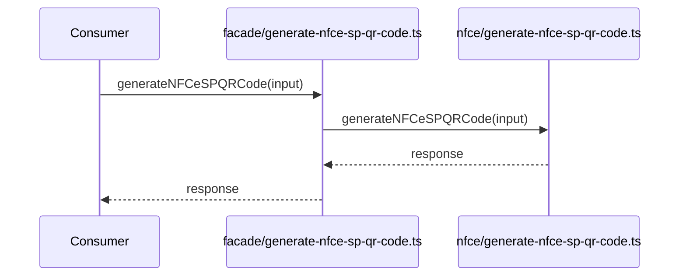

# src/canonical/facade/generate-nfce-sp-qr-code.ts

## Visao geral

Publica no barrel canonico a facade raiz de composicao do `QR Code` paulista de `NFC-e`.

## Responsabilidades

- Receber o request estruturado do integrador.
- Delegar a composicao local ao modulo interno de `NFC-e`.
- Preservar a superficie additive no import raiz sem expor subpaths novos.

## Entradas e saidas

- Entradas: `NFCeSPQRCodeRequest`.
- Saidas: `NFCeSPQRCodeResponse`.

## Fluxo principal



## Tratamento de erros e casos-limite

- A facade nao adiciona transformacoes extras.
- Erros de uso e boundaries permanecem concentrados no modulo interno.

## Exemplos

```ts
import { generateNFCeSPQRCode } from 'nfe-sdk';
```

## Dependencias e integracoes

- `../nfce/generate-nfce-sp-qr-code.js`
- `../nfce/contracts.js`