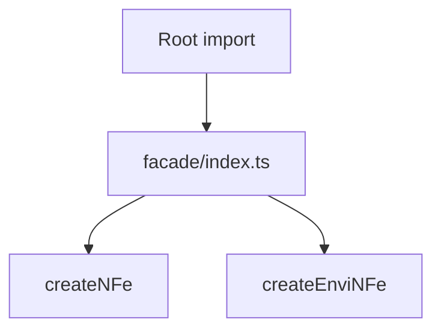

# src/canonical/facade/index.ts

## Visao geral

Agrega as funcoes publicas da facade canonica inicial.

## Responsabilidades

- Reexportar as funcoes de criacao publica.
- Servir como limite entre root import e implementacao interna.

## Entradas e saidas

- Entradas: nenhuma.
- Saidas: `createNFe` e `createEnviNFe`.

## Fluxo principal



## Tratamento de erros e casos-limite

- O arquivo nao valida entradas diretamente.
- As funcoes reexportadas concentram as validacoes.

## Exemplos

```ts
import { createEnviNFe, createNFe } from './index.js';
```

## Dependencias e integracoes

- `./create-envi-nfe.js`
- `./create-nfe.js`