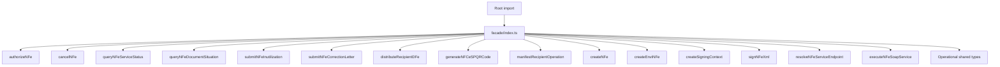

# src/canonical/facade/index.ts

## Visao geral

Agrega as funcoes publicas da facade manual publicada pelo barrel canonico e concentra os tipos compartilhados que alimentam a facade operacional.

## Responsabilidades

- Reexportar a autorizacao operacional de NFe publicada neste slice.
- Reexportar as manutencoes operacionais homologadas publicadas neste slice.
- Reexportar os wrappers publicos do slice recipient.
- Reexportar o helper root `generateNFCeSPQRCode` para o recorte paulista de `QR Code`.
- Reexportar as funcoes de criacao publica.
- Reexportar as funcoes publicas de assinatura digital.
- Reexportar os wrappers publicos do slice inicial de transporte SOAP.
- Reexportar os tipos compartilhados do slice operacional com autorizacao, consultas e manutencoes.
- Reexportar as consultas operacionais de status e situacao do documento.
- Servir como limite entre root import e implementacao interna.

## Entradas e saidas

- Entradas: nenhuma.
- Saidas: `authorizeNFe`, `cancelNFe`, `queryNFeServiceStatus`, `queryNFeDocumentSituation`, `submitNFeCorrectionLetter`, `submitNFeInutilization`, `distributeRecipientDFe`, `generateNFCeSPQRCode`, `manifestRecipientOperation`, `createNFe`, `createEnviNFe`, `createSigningContext`, `signNFeXml`, `resolveNFeServiceEndpoint`, `executeNFeSoapService` e tipos operacionais compartilhados.

## Fluxo principal



## Tratamento de erros e casos-limite

- O arquivo nao valida entradas diretamente.
- As funcoes reexportadas concentram as validacoes.

## Exemplos

```ts
import {
  authorizeNFe,
  cancelNFe,
  createEnviNFe,
  createNFe,
  createSigningContext,
  distributeRecipientDFe,
  executeNFeSoapService,
  generateNFCeSPQRCode,
  manifestRecipientOperation,
  queryNFeDocumentSituation,
  queryNFeServiceStatus,
  resolveNFeServiceEndpoint,
  signNFeXml,
  submitNFeCorrectionLetter,
  submitNFeInutilization,
} from './index.js';
```

## Dependencias e integracoes

- `./authorize-nfe.js`
- `./cancel-nfe.js`
- `./create-envi-nfe.js`
- `./create-nfe.js`
- `./create-signing-context.js`
- `./distribute-recipient-dfe.js`
- `./execute-nfe-soap-service.js`
- `./generate-nfce-sp-qr-code.js`
- `./manifest-recipient-operation.js`
- `./query-nfe-document-situation.js`
- `./query-nfe-service-status.js`
- `../nfe/index.js`
- `./resolve-nfe-service-endpoint.js`
- `./sign-nfe-xml.js`
- `./submit-nfe-correction-letter.js`
- `./submit-nfe-inutilization.js`