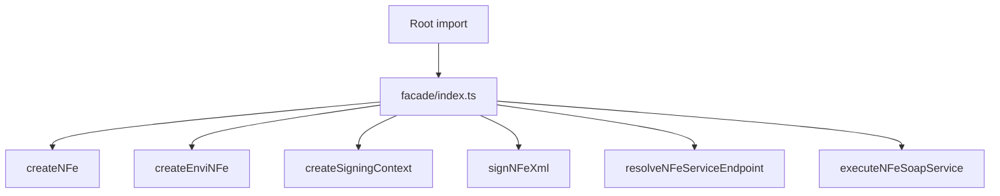

# src/canonical/facade/index.ts

## Visao geral

Agrega as funcoes publicas da facade manual publicada pelo barrel canonico.

## Responsabilidades

- Reexportar as funcoes de criacao publica.
- Reexportar as funcoes publicas de assinatura digital.
- Reexportar os wrappers publicos do slice inicial de transporte SOAP.
- Servir como limite entre root import e implementacao interna.

## Entradas e saidas

- Entradas: nenhuma.
- Saidas: `createNFe`, `createEnviNFe`, `createSigningContext`, `signNFeXml`, `resolveNFeServiceEndpoint` e `executeNFeSoapService`.

## Fluxo principal



## Tratamento de erros e casos-limite

- O arquivo nao valida entradas diretamente.
- As funcoes reexportadas concentram as validacoes.

## Exemplos

```ts
import {
  createEnviNFe,
  createNFe,
  createSigningContext,
  executeNFeSoapService,
  resolveNFeServiceEndpoint,
  signNFeXml,
} from './index.js';
```

## Dependencias e integracoes

- `./create-envi-nfe.js`
- `./create-nfe.js`
- `./create-signing-context.js`
- `./execute-nfe-soap-service.js`
- `./resolve-nfe-service-endpoint.js`
- `./sign-nfe-xml.js`