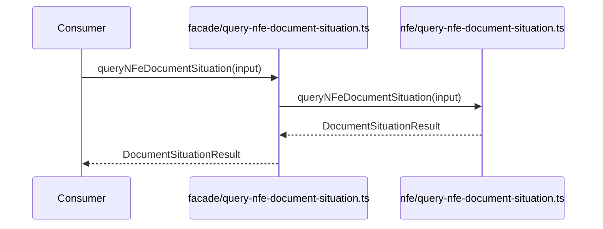

# src/canonical/facade/query-nfe-document-situation.ts

## Visao geral

Expõe a consulta estruturada da situacao do documento por chave de acesso no root import.

## Responsabilidades

- Receber o request estruturado do integrador.
- Delegar a consulta para a camada operacional.
- Preservar a fronteira entre facade publica e implementacao interna.

## Entradas e saidas

- Entradas: `DocumentSituationRequest`.
- Saidas: `Promise<DocumentSituationResult>`.

## Fluxo principal



## Tratamento de erros e casos-limite

- O wrapper nao adiciona validacoes novas.
- O dominio operacional concentra classificacao e evidencia.

## Exemplos

```ts
import { queryNFeDocumentSituation } from './query-nfe-document-situation.js';
```

## Dependencias e integracoes

- `../nfe/contracts.js`
- `../nfe/query-nfe-document-situation.js`