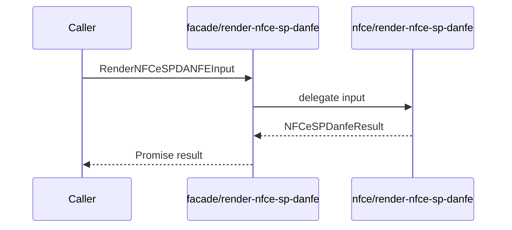

# Facade render-nfce-sp-danfe

## Visao geral

Expõe `renderNFCeSPDANFE` na facade publica, delegando a validacao e a geracao de HTML ao modulo de dominio NFC-e.

## Responsabilidades

- Preservar a assinatura tipada do renderer.
- Manter a facade publica pequena e sem duplicar validacoes.

## Entradas e saidas

- Entrada: `RenderNFCeSPDANFEInput`.
- Saida: `Promise<NFCeSPDanfeResult>` com HTML autocontido e metadados correlacionados.

## API / Assinatura

```ts
export function renderNFCeSPDANFE(
  input: RenderNFCeSPDANFEInput,
): Promise<NFCeSPDanfeResult>;
```

## Fluxo principal



## Tratamento de erros e casos-limite

- A facade nao altera nem captura erros do renderer.
- Evidencias inconsistentes e larguras invalidas rejeitam a Promise com o erro operacional NFC-e.

## Exemplos

```ts
const result = await renderNFCeSPDANFE({ authorization });
```

## Dependencias e integracoes

- `../nfce/render-nfce-sp-danfe.js`
- Contratos NFC-e em `../nfce/contracts.js`.
