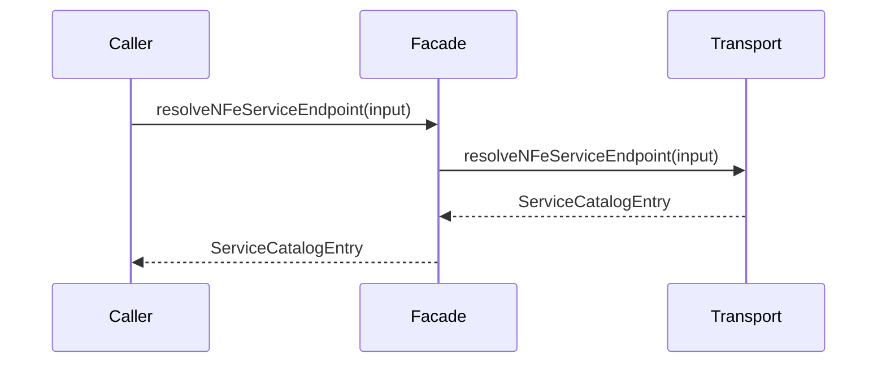

# src/canonical/facade/resolve-nfe-service-endpoint.ts

## Visao geral

Expoe a resolucao de endpoint de transporte como wrapper da fachada manual.

## Responsabilidades

- Receber a entrada do integrador.
- Delegar a resolucao ao modulo interno de transporte.
- Preservar a separacao entre facade publica e implementacao interna.

## Entradas e saidas

- Entradas: `ResolveNFeServiceEndpointInput`.
- Saidas: `ServiceCatalogEntry`.

## Fluxo principal



## Tratamento de erros e casos-limite

- Repassa os erros produzidos pela camada de transporte.

## Exemplos

```ts
const entry = resolveNFeServiceEndpoint({
  environment: 'homologation',
  service: 'nfe-status-service',
});
```

## Dependencias e integracoes

- `../transport/resolve-nfe-service-endpoint.ts`
- `./index.ts`