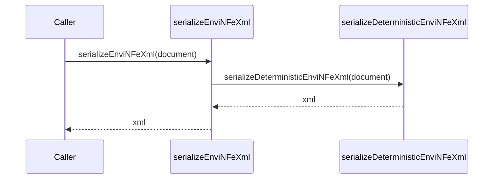

# src/canonical/facade/serialize-envi-nfe-xml.ts

## Visao geral

Expõe a serializacao publica de `enviNFe` no import raiz.

## Responsabilidades

- Receber o lote canonico `enviNFe`.
- Delegar a serializacao deterministica interna.

## Entradas e saidas

- Entradas: `CanonicalEnviNFeDocument`.
- Saidas: string XML.

## API / Assinatura

```ts
export function serializeEnviNFeXml(document: CanonicalEnviNFeDocument): string;
```

## Fluxo principal



## Tratamento de erros e casos-limite

- Preserva a mesma serializacao de `NFe` para cada documento interno do batch.

## Exemplos

```ts
const xml = serializeEnviNFeXml(batch);
```

## Dependencias e integracoes

- `../serialization/deterministic-xml`
- `../shared/contracts`