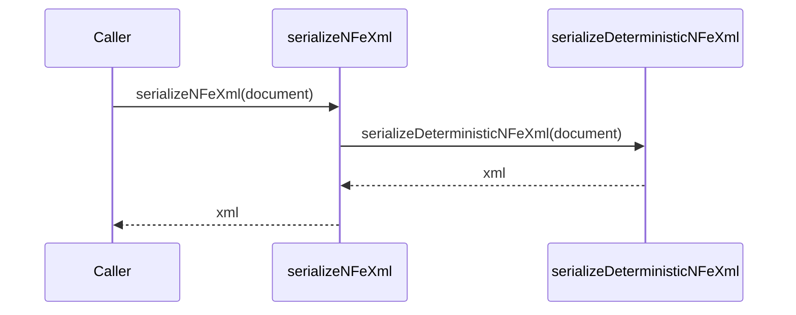

# src/canonical/facade/serialize-nfe-xml.ts

## Visao geral

Expõe a serializacao publica de `NFe` no import raiz.

## Responsabilidades

- Receber o documento canonico de `NFe`.
- Delegar a serializacao deterministica interna.

## Entradas e saidas

- Entradas: `CanonicalNFeDocument`.
- Saidas: string XML.

## API / Assinatura

```ts
export function serializeNFeXml(document: CanonicalNFeDocument): string;
```

## Fluxo principal



## Tratamento de erros e casos-limite

- Repassa o documento para o serializer sem alterar a ordem deterministica.

## Exemplos

```ts
const xml = serializeNFeXml(document);
```

## Dependencias e integracoes

- `../serialization/deterministic-xml`
- `../shared/contracts`