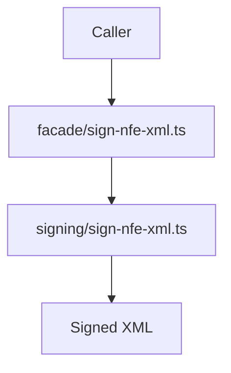

# src/canonical/facade/sign-nfe-xml.ts

## Visao geral

Expoe no barrel canonico a operacao publica que assina um XML nao assinado de `NFe`.

## Responsabilidades

- Receber `SigningContext` e `unsignedXml` do caller.
- Delegar a assinatura XMLDSig e a verificacao local ao slice interno.
- Devolver apenas XML assinado validado localmente.

## Entradas e saidas

- Entradas: `SignNFeXmlInput`.
- Saidas: `Promise<string>` com o XML assinado.

## Fluxo principal



## Tratamento de erros e casos-limite

- Nao executa validacao adicional de runtime.
- Falhas de assinatura ou verificacao sobem do slice interno.

## Exemplos

```ts
const signedXml = await signNFeXml({ signingContext, unsignedXml });
```

## Dependencias e integracoes

- `../signing/contracts.js`
- `../signing/sign-nfe-xml.js`