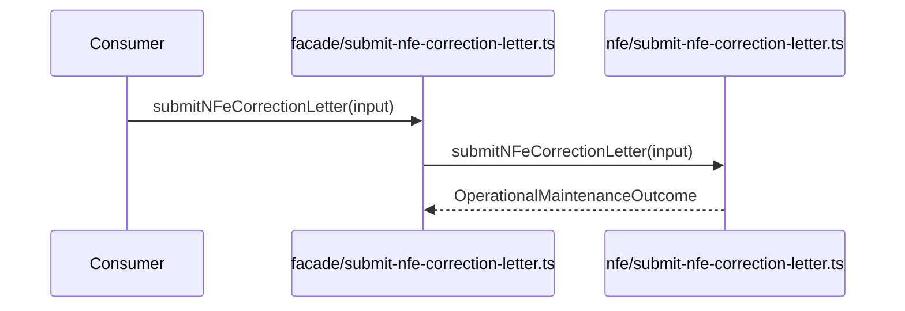

# src/canonical/facade/submit-nfe-correction-letter.ts

## Visao geral

Publica a carta de correcao homologada no barrel de facade manual.

## Responsabilidades

- Receber o input especifico da carta de correcao.
- Delegar a chamada para `../nfe/submit-nfe-correction-letter.js`.
- Manter a interface publica enxuta no import raiz.

## Entradas e saidas

- Entradas: `OperationalMaintenanceFacadeInput`.
- Saidas: `Promise<OperationalMaintenanceOutcome>`.

## Fluxo principal



## Tratamento de erros e casos-limite

- As regras de classificacao e boundary ficam no dominio operacional.

## Exemplos

```ts
import { submitNFeCorrectionLetter } from './submit-nfe-correction-letter.js';
```

## Dependencias e integracoes

- `../nfe/submit-nfe-correction-letter.js`
- `../nfe/contracts.js`
- `../nfe/maintenance-outcome.js`
