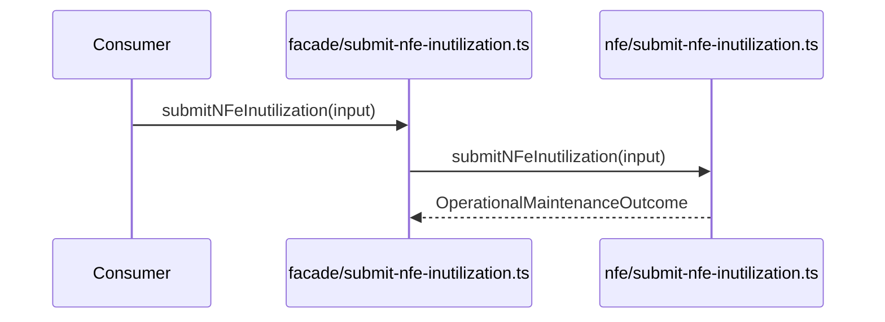

# src/canonical/facade/submit-nfe-inutilization.ts

## Visao geral

Publica a inutilizacao homologada no barrel de facade manual.

## Responsabilidades

- Receber o input especifico da inutilizacao.
- Delegar a chamada para `../nfe/submit-nfe-inutilization.js`.
- Preservar a separacao entre root import e implementacao operacional.

## Entradas e saidas

- Entradas: `OperationalMaintenanceFacadeInput`.
- Saidas: `Promise<OperationalMaintenanceOutcome>`.

## Fluxo principal



## Tratamento de erros e casos-limite

- O wrapper nao faz IO nem validacao adicional.

## Exemplos

```ts
import { submitNFeInutilization } from './submit-nfe-inutilization.js';
```

## Dependencias e integracoes

- `../nfe/submit-nfe-inutilization.js`
- `../nfe/contracts.js`
- `../nfe/maintenance-outcome.js`
