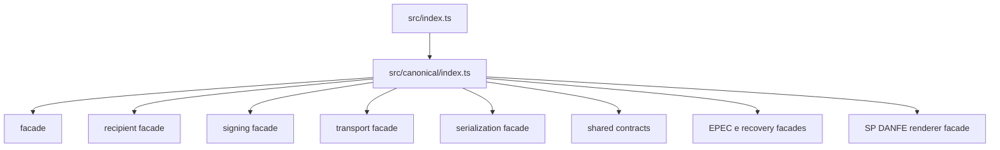

# src/canonical/index.ts

## Visao geral

Barrel da camada canonica manual publicada pelo root import.

## Responsabilidades

- Reexportar a facade publica de criacao canonica.
- Reexportar a facade publica inicial de autorizacao operacional.
- Reexportar o helper root paulista `generateNFCeSPQRCode`.
- Reexportar `renderNFCeSPDANFE` e os tipos publicos de resultado e entrada.
- Reexportar as facades de preparo e reconciliacao offline SP e a evidencia tipada de calendario.
- Reexportar as facades publicas iniciais de consulta operacional.
- Reexportar as facades publicas das tres manutencoes obrigatorias do MVP.
- Reexportar as facades publicas do slice recipient para distribuicao e manifestacao.
- Reexportar autorizacao, consulta de status, conciliacao de recibo e submissao EPEC para NF-e.
- Reexportar a facade publica de assinatura digital.
- Reexportar a facade publica inicial de transporte SOAP.
- Reexportar os tipos publicos usados pela facade.

## Entradas e saidas

- Entradas: nenhuma.
- Saidas: facades canonicas de NF-e/NFC-e, incluindo `authorizeNFe`, `queryNFeServiceStatus`, `reconcileNFeReceipt`, `prepareNFCeSPOffline`, `reconcileNFCeSPOffline` e `submitEPECEvent`, alem de tipos de contingencia e recovery.

## Fluxo principal



## Tratamento de erros e casos-limite

- O arquivo nao implementa regras de negocio.
- Falhas de validacao acontecem nos modulos de criacao.

## Exemplos

```ts
import {
  authorizeNFe,
  cancelNFe,
  createNFe,
  distributeRecipientDFe,
  generateNFCeSPQRCode,
  manifestRecipientOperation,
  queryNFeDocumentSituation,
  queryNFeServiceStatus,
  submitNFeCorrectionLetter,
  submitNFeInutilization,
} from './index.js';
```

## Dependencias e integracoes

- `./facade/authorize-nfe.js`
- `./facade/cancel-nfe.js`
- `./facade/create-envi-nfe.js`
- `./facade/create-nfe.js`
- `./facade/create-signing-context.js`
- `./facade/distribute-recipient-dfe.js`
- `./facade/execute-nfe-soap-service.js`
- `./facade/generate-nfce-sp-qr-code.js`
- `./facade/render-nfce-sp-danfe.js`
- `./facade/manifest-recipient-operation.js`
- `./facade/query-nfe-document-situation.js`
- `./facade/query-nfe-service-status.js`
- `./facade/resolve-nfe-service-endpoint.js`
- `./facade/serialize-envi-nfe-xml.js`
- `./facade/serialize-nfe-xml.js`
- `./facade/sign-nfe-xml.js`
- `./facade/submit-nfe-correction-letter.js`
- `./facade/submit-nfe-inutilization.js`
- `./signing/contracts.js`
- `./shared/contracts.js`
- `./transport/contracts.js`