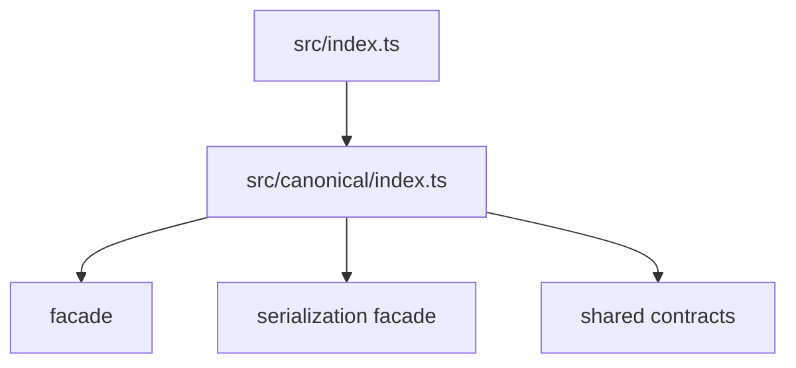

# src/canonical/index.ts

## Visao geral

Barrel da camada canonica inicial da feature 004.

## Responsabilidades

- Reexportar a facade publica de criacao canonica.
- Reexportar os tipos publicos usados pela facade.

## Entradas e saidas

- Entradas: nenhuma.
- Saidas: `createNFe`, `createEnviNFe`, `serializeNFeXml`, `serializeEnviNFeXml` e tipos canonicos.

## Fluxo principal



## Tratamento de erros e casos-limite

- O arquivo nao implementa regras de negocio.
- Falhas de validacao acontecem nos modulos de criacao.

## Exemplos

```ts
import { createNFe } from './index.js';
```

## Dependencias e integracoes

- `./facade/create-envi-nfe.js`
- `./facade/create-nfe.js`
- `./facade/serialize-envi-nfe-xml.js`
- `./facade/serialize-nfe-xml.js`
- `./shared/contracts.js`