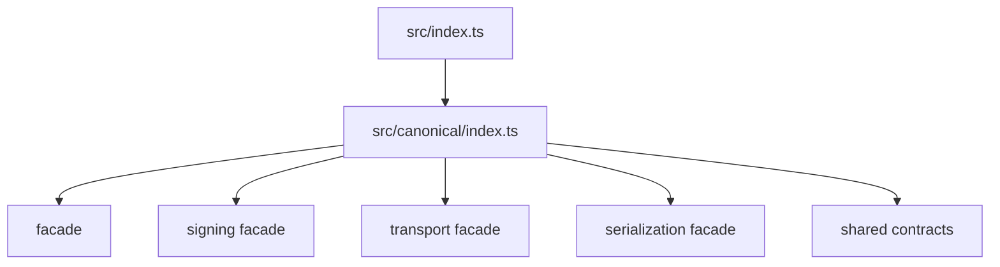

# src/canonical/index.ts

## Visao geral

Barrel da camada canonica manual publicada pelo root import.

## Responsabilidades

- Reexportar a facade publica de criacao canonica.
- Reexportar a facade publica de assinatura digital.
- Reexportar a facade publica inicial de transporte SOAP.
- Reexportar os tipos publicos usados pela facade.

## Entradas e saidas

- Entradas: nenhuma.
- Saidas: `createNFe`, `createEnviNFe`, `createSigningContext`, `resolveNFeServiceEndpoint`, `executeNFeSoapService`, `serializeNFeXml`, `serializeEnviNFeXml`, `signNFeXml` e tipos canonicos/de assinatura/transporte.

## Fluxo principal



## Tratamento de erros e casos-limite

- O arquivo nao implementa regras de negocio.
- Falhas de validacao acontecem nos modulos de criacao.

## Exemplos

```ts
import { createNFe } from './index.js';
```

## Dependencias e integracoes

- `./facade/create-envi-nfe.js`
- `./facade/create-nfe.js`
- `./facade/create-signing-context.js`
- `./facade/execute-nfe-soap-service.js`
- `./facade/resolve-nfe-service-endpoint.js`
- `./facade/serialize-envi-nfe-xml.js`
- `./facade/serialize-nfe-xml.js`
- `./facade/sign-nfe-xml.js`
- `./signing/contracts.js`
- `./shared/contracts.js`
- `./transport/contracts.js`