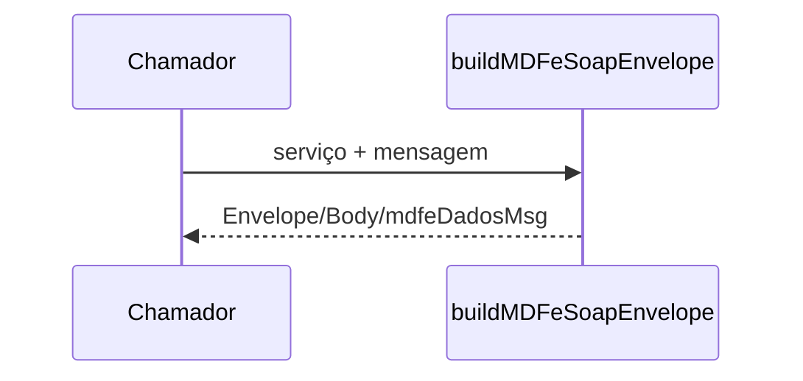

# build-mdfe-soap-envelope

## Visão geral

Monta o envelope SOAP 1.2 de um serviço MDF-e.

## Responsabilidades

Coloca a mensagem em `mdfeDadosMsg` com o namespace do WSDL do serviço; só a distribuição leva `mdfeCabecMsg` (cUF e versaoDados).

## Entradas e saídas

Entrada: serviço, mensagem e `headerUF`. Saída: texto do envelope.

## Fluxo principal



## Tratamento de erros e casos-limite

A declaração XML da mensagem é removida. O contrato do envelope não foi conferido contra o WSDL (acesso exige certificado).

## Exemplos

```ts
buildMDFeSoapEnvelope('mdfe-status-service', xml);
```

## Dependências e integrações

[mdfe-service-definitions.ts](./mdfe-service-definitions.ts).
