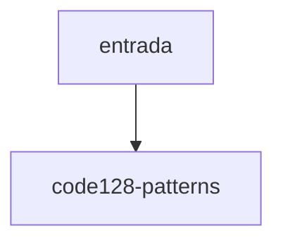

# code128-patterns

## Visão geral

Tabela de larguras de barras do Code 128.

## Responsabilidades

107 símbolos (0 a 106) como dígitos alternando barra e espaço.

## Entradas e saídas

Constante `CODE128_PATTERNS`.

## Fluxo principal



Consultada pelo desenho do código de barras.

## Tratamento de erros e casos-limite

Cada símbolo soma 11 módulos (13 o Stop); o teste confere o formato e a unicidade, não a leitura por scanner.

## Exemplos

```ts
CODE128_PATTERNS[105]
```

## Dependências e integrações

[code128.ts](./code128.ts).
