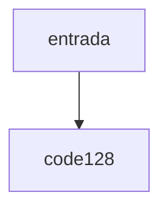

# code128

## Visão geral

Codificação Code 128 conjunto C.

## Responsabilidades

Gera Start C, pares de dígitos, dígito verificador (soma ponderada módulo 103) e Stop.

## Entradas e saídas

Entrada: dígitos em quantidade par. Saída: valores dos símbolos.

## Fluxo principal



Função pura.

## Tratamento de erros e casos-limite

Entrada vazia, ímpar ou não numérica lança `Error`.

## Exemplos

```ts
encodeCode128C('12345678');
```

## Dependências e integrações

[code128-patterns.ts](./code128-patterns.ts).
