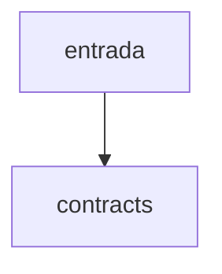

# contracts

## Visão geral

Contratos de dados do módulo MDF-e (somente consumo).

## Responsabilidades

Define as versões de layout, os resumos de documento e evento, o protocolo, os totais e os tipos de resultado das operações.

## Entradas e saídas

Tipos TypeScript e a constante `MDFE_LAYOUT_VERSION` (`3.00`).

## Fluxo principal



parse-mdfe.ts, consultas e distribuição produzem estes tipos.

## Tratamento de erros e casos-limite

Nenhum comportamento em tempo de execução além da constante.

## Exemplos

```ts
import type { MDFeDocumentSummary } from '@linkiez/nfe-sdk';
```

## Dependências e integrações

Usado por todos os arquivos do módulo.
