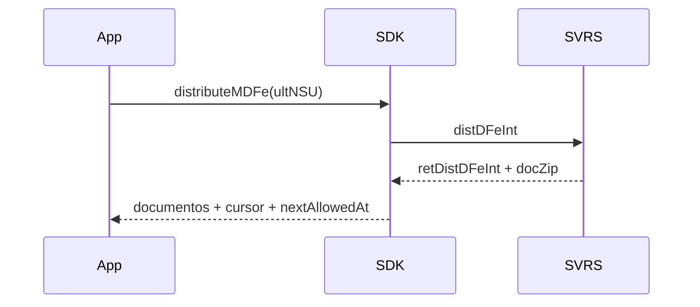

# distribute-mdfe

## Visão geral

Distribuição de DF-e de interesse do MDF-e (`distNSU` e `consNSU`).

## Responsabilidades

Busca documentos e eventos por cursor (`ultNSU`) ou por um NSU, descompacta os `docZip` (GZip/Base64), lê MDF-e e eventos, devolve o cursor e impõe `nextAllowedAt` de 1 hora quando `ultNSU = maxNSU` ou na rejeição 678 (`misuse`).

## Entradas e saídas

Entrada: id do ator, ambiente, `ultNSU` ou `nsu`, executor, `headerUF`. Saída: `MDFeDistributionResult`.

## Fluxo principal



## Tratamento de erros e casos-limite

Cursor inválido, id inválido, nenhum ou ambos os seletores: `usage-error`. Rejeição 730 informa `minimumNSU`. Produção: `unsupported` mantendo o cursor. Quem chama persiste `cursor.ultNSU`.

## Exemplos

```ts
await distributeMDFe({ taxId, environment: 'homologation', ultNSU, requestExecutor });
```

## Dependências e integrações

[parse-mdfe.ts](./parse-mdfe.ts), pacote `PL_MDFeDistDFe_100`.
