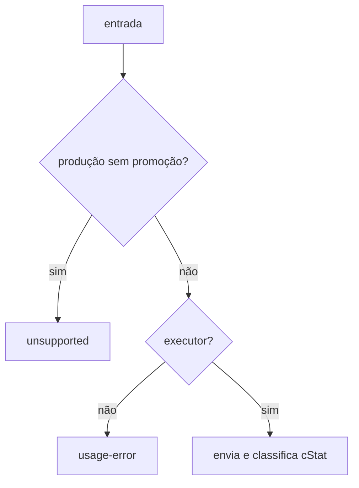

# execute-mdfe-soap-service

## Visão geral

Envia uma mensagem a um serviço MDF-e e classifica a resposta pelo `cStat`.

## Responsabilidades

Recusa produção não promovida (`unsupported`) e a falta de executor com TLS mútuo (`usage-error`); classifica `success`, `unavailable` (108/109), `functional-rejection`, `protocol-error` e `timeout`.

## Entradas e saídas

Entrada: serviço, ambiente, mensagem, executor, timeout e `headerUF`. Saída: resultado com `responseXml`.

## Fluxo principal



## Tratamento de erros e casos-limite

Resposta sem `cStat`: `protocol-error`. `AbortError`: `timeout`. Outro erro do executor: `MDFeTransportError`.

## Exemplos

```ts
await executeMDFeSoapService({ service, environment, payloadXml, requestExecutor });
```

## Dependências e integrações

[build-mdfe-soap-envelope.ts](./build-mdfe-soap-envelope.ts), [resolve-mdfe-endpoint.ts](./resolve-mdfe-endpoint.ts).
