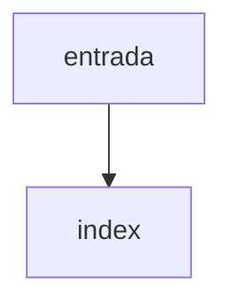

# index

## Visão geral

Ponto de entrada do módulo MDF-e.

## Responsabilidades

Reexporta as operações e os tipos de consumo do MDF-e.

## Entradas e saídas

Funções e tipos listados no README (seção MDF-e).

## Fluxo principal



Apenas reexportações.

## Tratamento de erros e casos-limite

Nenhum.

## Exemplos

```ts
import { parseMDFeXml } from '@linkiez/nfe-sdk';
```

## Dependências e integrações

[src/canonical/index.ts](../index.ts).
