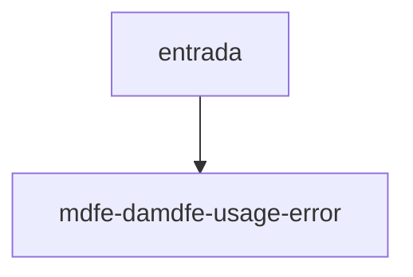

# mdfe-damdfe-usage-error

## Visão geral

Erro de uso de `renderDAMDFE`.

## Responsabilidades

Indica XML malformado, evento, ou documento não autorizado.

## Entradas e saídas

Entrada: mensagem. Saída: `MDFeDamdfeUsageError`.

## Fluxo principal



Lançado por `renderDAMDFE`.

## Tratamento de erros e casos-limite

Nunca desenha PDF para documento sem `cStat` 100.

## Exemplos

```ts
catch (e) { e instanceof MDFeDamdfeUsageError }
```

## Dependências e integrações

[render-damdfe.ts](./render-damdfe.ts).
