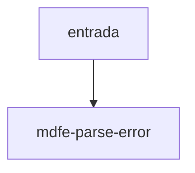

# mdfe-parse-error

## Visão geral

Erro de leitura de XML de MDF-e.

## Responsabilidades

Carrega o código (`not-xml`, `unsupported-root`, `unsupported-version`, `missing-field`) para o chamador decidir o tratamento.

## Entradas e saídas

Entrada: código e mensagem. Saída: `MDFeParseError`.

## Fluxo principal



Lançado por `parseMDFeXml`.

## Tratamento de erros e casos-limite

Nunca contém trecho do XML.

## Exemplos

```ts
try { parseMDFeXml(xml); } catch (e) { if (e instanceof MDFeParseError) e.code; }
```

## Dependências e integrações

[parse-mdfe.ts](./parse-mdfe.ts).
