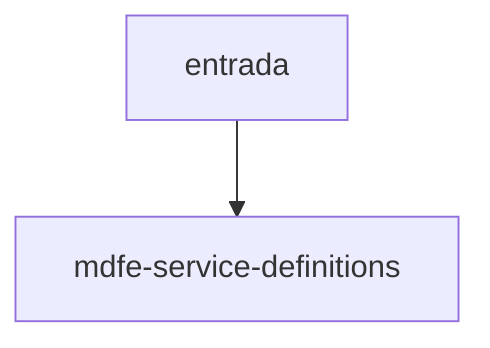

# mdfe-service-definitions

## Visão geral

Definições dos serviços SOAP de consumo do MDF-e.

## Responsabilidades

Reúne nome do serviço, método, `cStat` de sucesso, versão de leiaute, uso do cabeçalho SOAP e a promoção para produção.

## Entradas e saídas

Constantes `MDFE_SERVICE_DEFINITIONS` e o tipo `SupportedMDFeSoapService`.

## Fluxo principal



Consultado por envelope, endpoint e execução.

## Tratamento de erros e casos-limite

`productionPromoted` é falso em todas as operações até a feature 039.

## Exemplos

```ts
MDFE_SERVICE_DEFINITIONS['mdfe-distribution'].method
```

## Dependências e integrações

Fontes: MOC 3.00b (MOC Online) e registro de rotas da spec 030.
