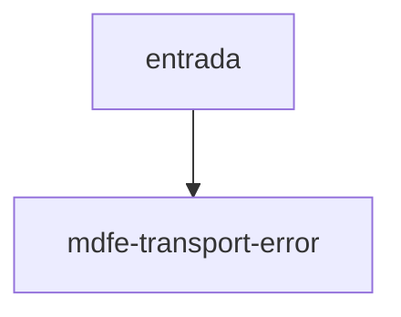

# mdfe-transport-error

## Visão geral

Falha do executor de requisições que não é timeout.

## Responsabilidades

Encapsula a causa original.

## Entradas e saídas

Entrada: mensagem e causa. Saída: `MDFeTransportError`.

## Fluxo principal



Lançado por `executeMDFeSoapService`.

## Tratamento de erros e casos-limite

Timeout não gera este erro: vira `timeout`.

## Exemplos

```ts
catch (e) { e instanceof MDFeTransportError }
```

## Dependências e integrações

[execute-mdfe-soap-service.ts](./execute-mdfe-soap-service.ts).
