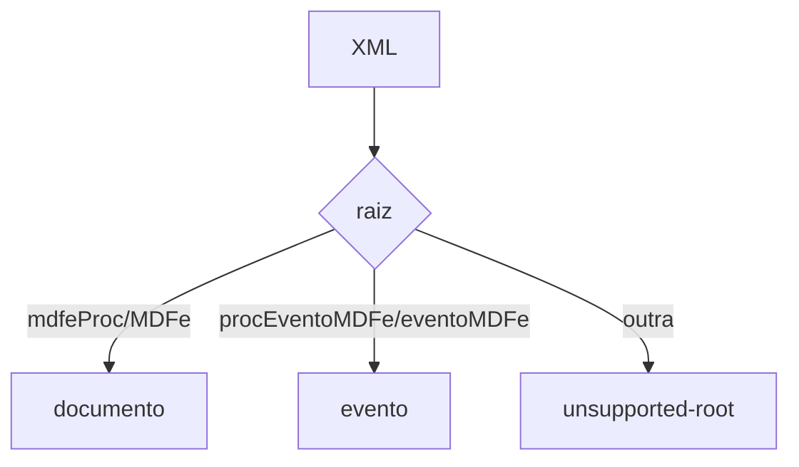

# parse-mdfe

## Visão geral

Leitura tipada de documento e evento de MDF-e.

## Responsabilidades

`parseMDFeXml` lê `mdfeProc`/`MDFe` e `procEventoMDFe`/`eventoMDFe`, exige versão `3.00` em todos os `versao` encontrados e não valida esquema nem assinatura.

## Entradas e saídas

Entrada: texto XML. Saída: `MDFeDocumentSummary` (com placas, condutores, municípios de descarga e documentos vinculados) ou `MDFeEventSummary`.

## Fluxo principal



## Tratamento de erros e casos-limite

`MDFeParseError`: `not-xml`, `unsupported-root`, `unsupported-version`, `missing-field`. `authorized` só com `cStat` 100; evento `registered` só com 135/136.

## Exemplos

```ts
parseMDFeXml(xml);
```

## Dependências e integrações

[read-mdfe-protocol.ts](./read-mdfe-protocol.ts), [parse-xml-tree.ts](./parse-xml-tree.ts).
