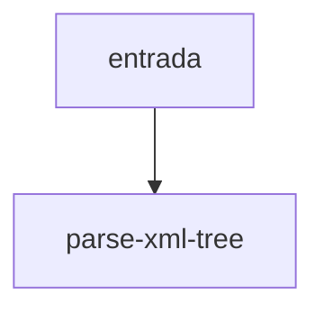

# parse-xml-tree

## Visão geral

Converte texto XML em `XmlNode`.

## Responsabilidades

Usa `@xmldom/xmldom` e devolve `undefined` quando o texto está vazio ou malformado.

## Entradas e saídas

Entrada: texto XML. Saída: raiz ou `undefined`.

## Fluxo principal



Erros do parser (inclusive exceções) viram `undefined`.

## Tratamento de erros e casos-limite

Texto vazio, texto que não é XML.

## Exemplos

```ts
const root = parseXmlTree(xml);
```

## Dependências e integrações

[xml-node.ts](./xml-node.ts).
