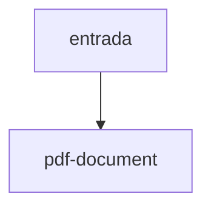

# pdf-document

## Visão geral

Escritor mínimo de PDF 1.4 (A4, Helvetica, sem dependências).

## Responsabilidades

`PdfPage` desenha texto e retângulos; `PdfDocument` serializa as páginas.

## Entradas e saídas

Entrada: chamadas de desenho. Saída: bytes do PDF.

## Fluxo principal



Sem compressão; o conteúdo é texto Latin-1.

## Tratamento de erros e casos-limite

Caracteres fora de Latin-1 viram `?`.

## Exemplos

```ts
const page = new PdfDocument().addPage(); page.text(36, 800, 'Olá');
```

## Dependências e integrações

Usado por render-damdfe.ts.
