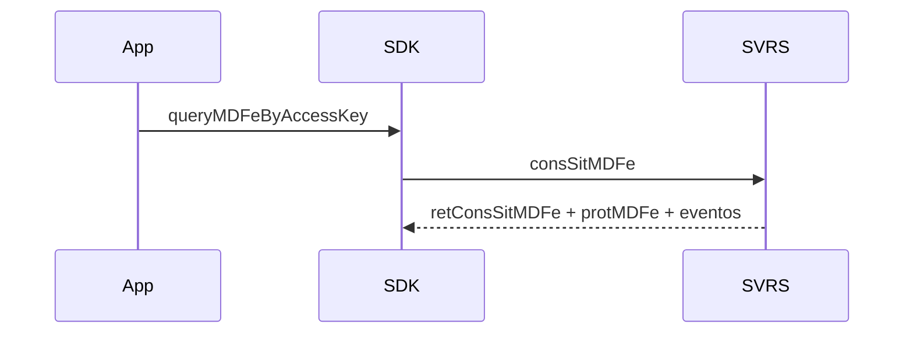

# query-mdfe-by-access-key

## Visão geral

Consulta a situação de um MDF-e pela chave (`consSitMDFe`).

## Responsabilidades

Devolve situação (`authorized` 100, `canceled` 101, `closed` 132, `not-found` 217), protocolo, eventos registrados, blocos brutos e o grupo InfraSA. O serviço só atende até 180 dias da emissão.

## Entradas e saídas

Entrada: chave (44 dígitos, modelo 58), ambiente, executor. Saída: `MDFeAccessKeyQueryResult`.

## Fluxo principal



## Tratamento de erros e casos-limite

Chave inválida ou de outro modelo: `usage-error` sem enviar. Produção: `unsupported`.

## Exemplos

```ts
await queryMDFeByAccessKey({ accessKey, environment: 'homologation', requestExecutor });
```

## Dependências e integrações

[parse-mdfe.ts](./parse-mdfe.ts), [read-mdfe-protocol.ts](./read-mdfe-protocol.ts).
