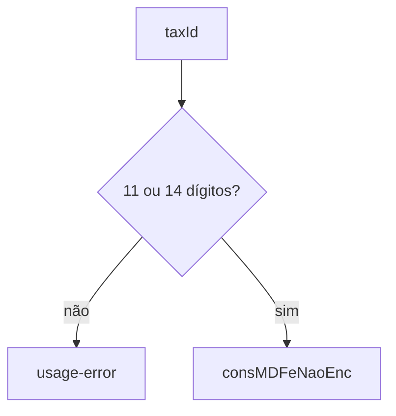

# query-mdfe-not-closed

## Visão geral

Lista os MDF-e autorizados e não encerrados do emitente (`consMDFeNaoEnc`).

## Responsabilidades

`cStat` 111 lista chave e protocolo; 112 significa nenhum. O acesso é restrito ao CNPJ/CPF do emitente.

## Entradas e saídas

Entrada: CNPJ/CPF, ambiente, executor. Saída: `MDFeNotClosedQueryResult` com `items`.

## Fluxo principal



## Tratamento de erros e casos-limite

Identificador inválido: `usage-error`. Produção: `unsupported`.

## Exemplos

```ts
await queryMDFeNotClosed({ taxId, environment: 'homologation', requestExecutor });
```

## Dependências e integrações

[execute-mdfe-soap-service.ts](./execute-mdfe-soap-service.ts).
