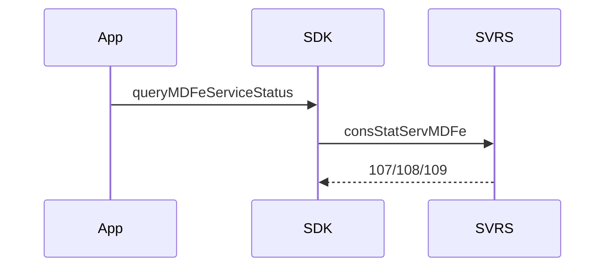

# query-mdfe-service-status

## Visão geral

Consulta o status do serviço do autorizador MDF-e (`consStatServMDFe`).

## Responsabilidades

`available` só com `cStat` 107; quem consulta em laço deve esperar ao menos 3 minutos entre chamadas.

## Entradas e saídas

Entrada: ambiente, executor e timeout. Saída: `MDFeServiceStatusResult`.

## Fluxo principal



## Tratamento de erros e casos-limite

Produção: `unsupported` sem enviar.

## Exemplos

```ts
await queryMDFeServiceStatus({ environment: 'homologation', requestExecutor });
```

## Dependências e integrações

[execute-mdfe-soap-service.ts](./execute-mdfe-soap-service.ts).
