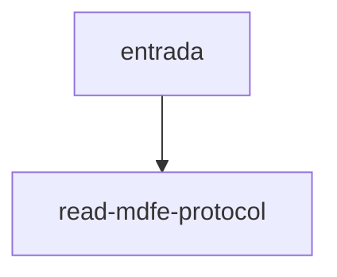

# read-mdfe-protocol

## Visão geral

Leitura do protocolo `protMDFe/infProt`.

## Responsabilidades

Aceita o próprio `protMDFe` ou um elemento que o contenha.

## Entradas e saídas

Entrada: nó. Saída: `MDFeProtocol` ou `undefined`.

## Fluxo principal



Procura `protMDFe` e depois `infProt`.

## Tratamento de erros e casos-limite

Sem `nProt` ou `cStat` resulta em `undefined`.

## Exemplos

```ts
readMDFeProtocol(root);
```

## Dependências e integrações

Usado por parse-mdfe.ts e por query-mdfe-by-access-key.ts.
