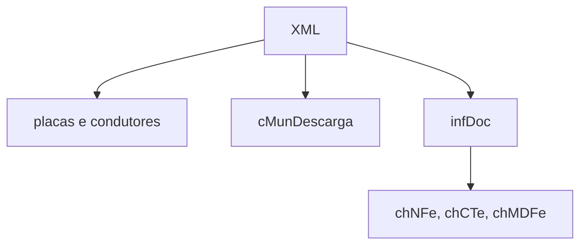

# read-mdfe-transport-facts

## Visão geral

Lê placas, condutores, municípios de descarga e chaves dos documentos vinculados de um MDF-e.

## Responsabilidades

Extrair esses fatos do XML sem repetição; as chaves vêm só de `infDoc`, então a chave do protocolo de um `mdfeProc` nunca é listada como documento vinculado.

## Entradas e saídas

Entrada: XML do `mdfeProc` ou `MDFe`. Saída: `vehiclePlates`, `drivers`, `unloadingMunicipalityCodes`, `linkedDocuments`.

## Fluxo principal



## Tratamento de erros e casos-limite

Elementos ausentes resultam em listas vazias; não lança exceções.

## Exemplos

```ts
readMDFeTransportFacts(xml).linkedDocuments;
```

## Dependências e integrações

Usado por [parse-mdfe.ts](./parse-mdfe.ts).
