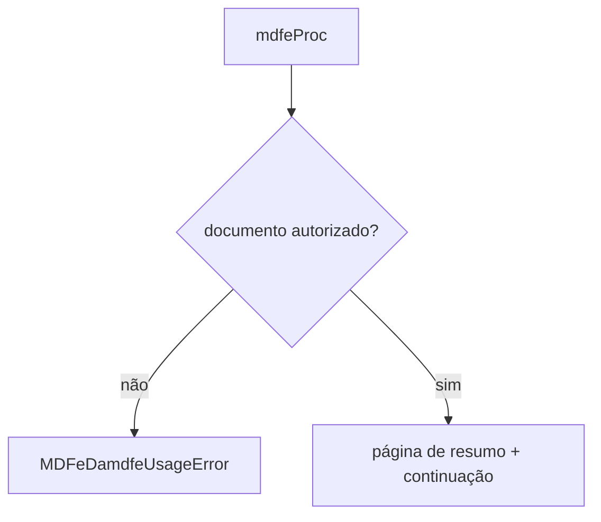

# render-damdfe

## Visão geral

Resumo em PDF de um MDF-e autorizado (DAMDFE simplificado).

## Responsabilidades

Desenha chave com código de barras Code 128C, protocolo, emitente, rota, placas, totais e chaves dos documentos; aviso de homologação quando `tpAmb` 2; imprime só o que está no XML. Não desenha o QR Code nem o leiaute oficial por modal.

## Entradas e saídas

Entrada: `{ authorizedXml }`. Saída: bytes do PDF.

## Fluxo principal



## Tratamento de erros e casos-limite

Evento, sem protocolo, `cStat` diferente de 100 ou XML inválido: `MDFeDamdfeUsageError`. A lista de documentos continua em novas páginas.

## Exemplos

```ts
await renderDAMDFE({ authorizedXml });
```

## Dependências e integrações

[code128.ts](./code128.ts), [pdf-document.ts](./pdf-document.ts), [parse-mdfe.ts](./parse-mdfe.ts).
