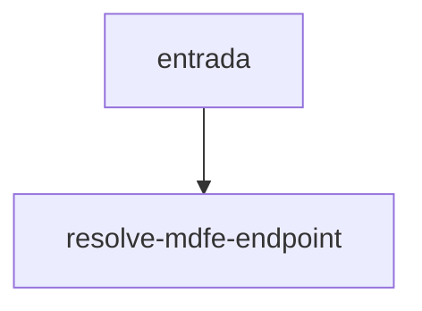

# resolve-mdfe-endpoint

## Visão geral

Rota SVRS de um serviço MDF-e.

## Responsabilidades

Homologação `https://mdfe-homologacao.svrs.rs.gov.br/ws/<Serviço>/<Serviço>.asmx` e produção `https://mdfe.svrs.rs.gov.br/ws/...`.

## Entradas e saídas

Entrada: serviço e ambiente. Saída: URL.

## Fluxo principal



Função pura.

## Tratamento de erros e casos-limite

Não decide se a operação está liberada em produção.

## Exemplos

```ts
resolveMDFeEndpoint('mdfe-document-situation', 'homologation');
```

## Dependências e integrações

Registro de rotas R-HOM/R-PROD da spec 030.
