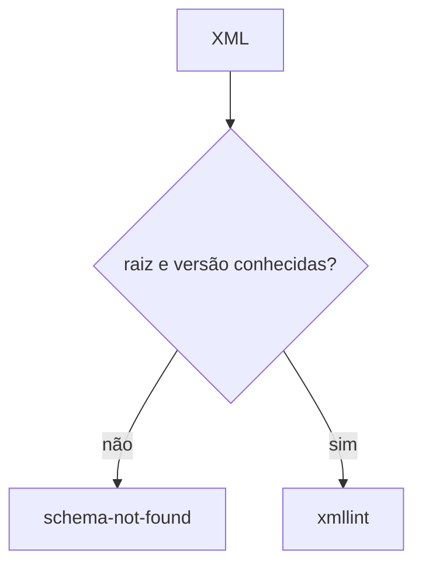

# validate-mdfe

## Visão geral

Validação por XSD de mensagens de MDF-e com `xmllint`.

## Responsabilidades

Escolhe o esquema pela raiz e pela versão (documento, evento, consultas e distribuição) nos pacotes `PL_MDFe_300b_NT012025_1.05` e `PL_MDFeDistDFe_100`.

## Entradas e saídas

Entrada: XML e `xsdDir` opcional. Saída: `MDFeValidationResult` (resultado do XSD + `schemaFile`).

## Fluxo principal



## Tratamento de erros e casos-limite

Raiz ou versão desconhecida: `schema-not-found` sem adivinhar. Sem `xmllint`: `xmllint-unavailable`. Os XSD ficam em `xsd/` do repositório e não vão no tarball: informe `xsdDir` fora dele.

## Exemplos

```ts
validateMDFeXml(xml);
```

## Dependências e integrações

[validate-nfe-xsd.ts](../validation/validate-nfe-xsd.ts).
