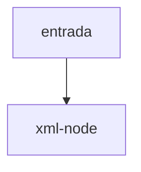

# xml-node

## Visão geral

Visão somente leitura, sem namespace, de um elemento XML.

## Responsabilidades

Oferece `name`, `attr`, `find` (primeiro descendente por nome local) e `text` (texto aparado por caminho).

## Entradas e saídas

Entrada: elemento DOM. Saída: valores de texto ou `undefined`.

## Fluxo principal



Busca em profundidade; o primeiro descendente com o nome vence.

## Tratamento de erros e casos-limite

Texto vazio vira `undefined`.

## Exemplos

```ts
node.text('ide', 'tpAmb');
```

## Dependências e integrações

[parse-xml-tree.ts](./parse-xml-tree.ts).
