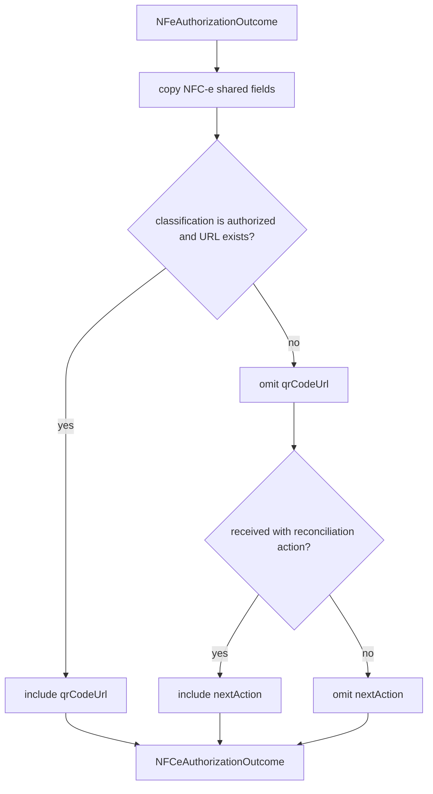

# authorization-outcome.ts

## Visao geral

Adapta o resultado compartilhado de autorizacao NF-e para o contrato publico NFC-e, sem alterar a classificacao ou os dados de transporte.

## Responsabilidades

- Preservar classificacao, protocolo, recibo, evidencias e falhas de validacao do resultado de origem.
- Acrescentar `qrCodeUrl` somente quando o resultado estiver autorizado e uma URL tiver sido fornecida.
- Preservar `reconcileNFeReceipt` como proxima acao somente para um resultado `received` que a origem marcou para reconciliacao.
- Evitar que resultados rejeitados ou incertos parecam associados a um QR de documento autorizado.

## Entradas e saidas

- Entrada: `NFeAuthorizationOutcome` e uma URL QR opcional.
- Saida: `NFCeAuthorizationOutcome` com os campos compartilhados, URL condicional e proxima acao condicional.

## Fluxo principal



## Tratamento de erros e casos-limite

- A ausencia de URL nao altera a classificacao do resultado.
- Uma URL fornecida junto a qualquer classificacao diferente de `authorized` e omitida.
- `nextAction` so e propagada para `received` quando a origem indica `reconcileNFeReceipt`; o mapper nao executa essa acao.
- O mapper nao valida a URL; chave, ambiente e CSC sao responsabilidade do fluxo que a compoe.

## Exemplos

```ts
const outcome = mapNFCeAuthorizationOutcome(authorizedNFeOutcome, qrCodeUrl);
```

## Dependencias e integracoes

- `../nfe/contracts.js` define o resultado compartilhado de autorizacao.
- `./contracts.js` define o contrato NFC-e.
