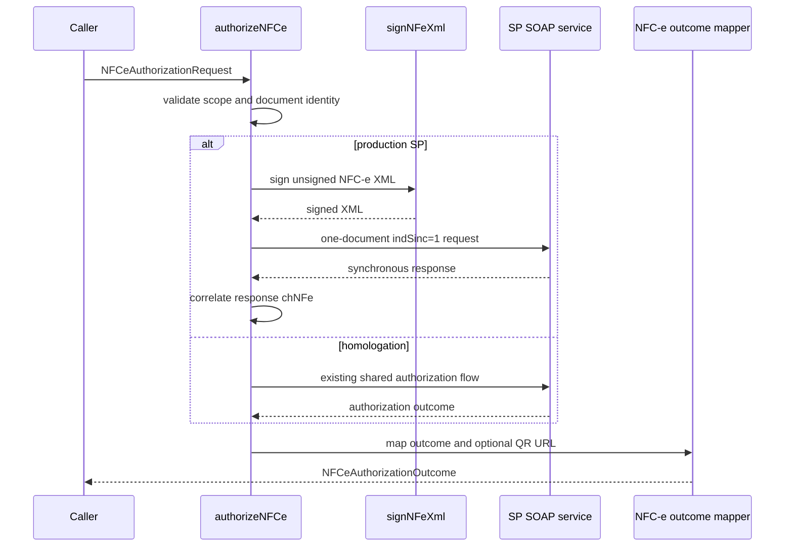

# authorize-nfce.ts

## Visao geral

Expõe a autorizacao NFC-e pelo facade interno. Mantem o fluxo homologado SP/PR e habilita envio sincronico em producao para NFC-e modelo 65 de SP.

## Responsabilidades

- Validar ambiente, escopo estadual, todos os campos fiscais derivados da chave, identificador do emitente no XML fiscal, CSC e transporte antes de uma autorizacao de producao.
- Assinar o XML NFC-e com o `SigningContext` do SDK e enviar um unico documento pelo servico paulista normal.
- Mapear a resposta sincronica e compor a URL QR v3 somente depois de autorizacao confirmada.

## Entradas e saidas

- Entrada: `NFCeAuthorizationRequest`, com documento, ambiente e contexto de assinatura; producao tambem exige `unsignedXml`, `csc` e `requestExecutor` mTLS-capable.
- Saida: `NFCeAuthorizationOutcome`, com classificacao, protocolo preservado como texto, evidencias de transporte e `qrCodeUrl` opcional.

## Fluxo principal



## Tratamento de erros e casos-limite

- Producao fora de SP, chave que nao seja modelo 65, ambiente divergente, CNPJ/CPF do emitente diferente da chave, campos fiscais incoerentes com a chave, XML incompatível, assinatura ausente, CSC ausente ou executor ausente falham antes do transporte.
- Uma resposta de autorizacao com `chNFe` ausente ou diferente da chave solicitada e classificada como `protocol-error`; nenhuma URL QR e retornada.
- Uma resposta `received` com recibo pode indicar `reconcileNFeReceipt` como proxima acao; o fluxo nao executa reconciliacao, polling ou retry automaticamente.
- Rejeicao, pendencia, timeout, indisponibilidade e erro de protocolo nao recebem URL QR. O fluxo nao repete a requisicao nem troca para contingencia.
- O token CSC nao integra a URL v3 nem o resultado publico.

## Exemplos

```ts
const outcome = await authorizeNFCe({
  document: { documentId: accessKey, environment: 'production', version: '4.00' },
  environment: 'production',
  signingContext,
  requestExecutor,
  unsignedXml,
  csc: { cscId: '000001', cscToken },
});
```

## Dependencias e integracoes

- `../signing/sign-nfe-xml.js` assina o XML fiscal.
- `../transport/execute-nfe-soap-service.js` encaminha uma requisicao pelo catalogo de servicos.
- `./generate-nfce-sp-qr-code.js` compoe a URL v3 paulista.
- `./authorization-outcome.js` adapta o resultado compartilhado ao contrato NFC-e.