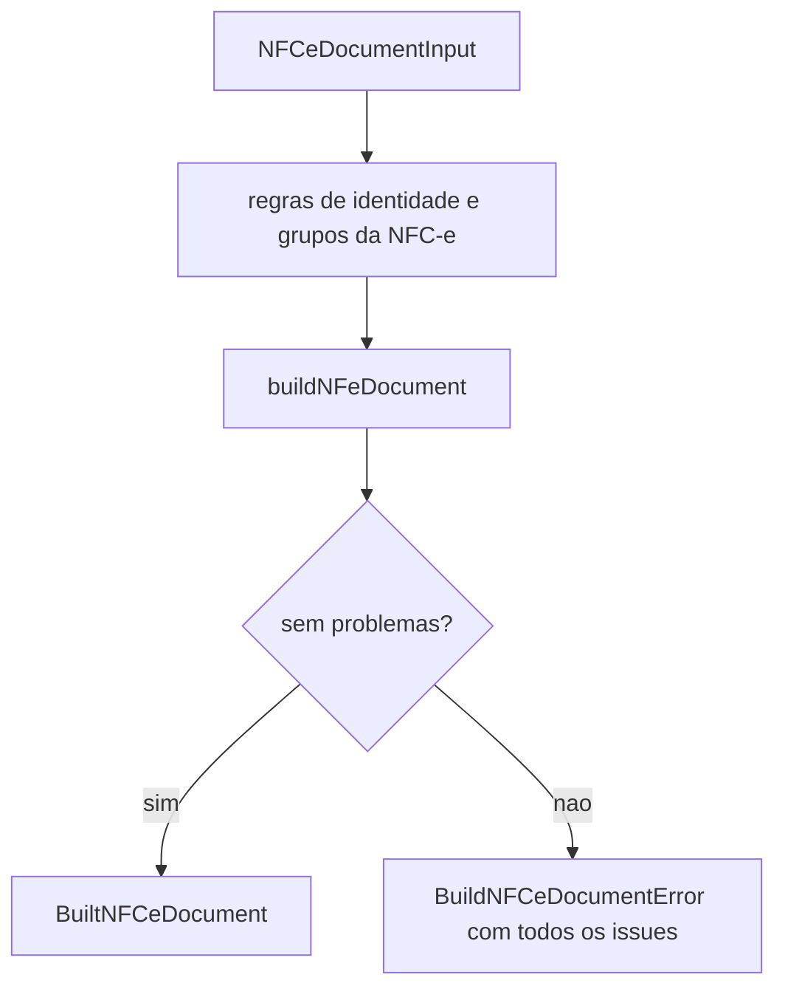

# src/canonical/nfce/build-nfce-document.ts

## Visao geral

Monta o XML `NFe` nao assinado de uma `NFC-e` (modelo 65, layout 4.00) a partir de um rascunho tipado, reaproveitando o construtor da NF-e (`buildNFeDocument`): mesmo XSD, derivacao de `cNF`, `cDV` e chave de acesso, `Id`, numeracao dos itens e serializacao na ordem do layout.

## Responsabilidades

- Conferir antes de montar o que so a `NFC-e` fixa: `mod` 65, `tpNF` 1, `idDest` 1, `finNFe` 1, `indFinal` 1, `indPres` 1 ou 4, `tpImp` 4 ou 5 e `tpEmis` 1 (normal) ou 9 (contingencia offline).
- Na contingencia offline (`tpEmis` 9) exigir `indPres` 1, `dhCont` e `xJust` de 15 a 256 caracteres.
- Recusar os grupos que nao existem na `NFC-e`: transporte alem de `modFrete` 9, `cobr`, `entrega` e `retirada`; exigir ao menos um pagamento. O consumidor (`dest`) e opcional.
- Aplicar as regras do modelo 65 de [nfce-model-rules](./nfce-model-rules.doc.md) (CFOP, CST, CSOSN, grupos vedados, pagamento e totais).
- Acrescentar `infNFeSupl` (QR Code v3 em `qrCode` e a URL de consulta por chave em `urlChave`) a toda NFC-e online de SP (`tpEmis` 1): o grupo fica depois de `infNFe`, fora da referencia assinada, e a assinatura continua valida. A contingencia offline nao recebe o grupo aqui, porque o QR Code dela depende da assinatura ou do CSC e e composto em `prepareNFCeSPOffline`; UF sem evidencia na matriz tambem nao recebe.
- Reunir no mesmo erro os problemas do construtor da NF-e (campos desconhecidos, valores fora do limite, chave invalida).

## Entradas e saidas

- Entrada: `NFCeDocumentInput` (igual a `NFeDocumentInput`, nomes do XSD, decimais como texto).
- Saida: `BuiltNFCeDocument` com `accessKey` (modelo 65), `cDV`, `cNF`, `id` e `xml`.
- Falha: `BuildNFCeDocumentError` com `issues`, cada uma iniciada pelo caminho do campo.

## API / Assinatura

```ts
export function buildNFCeDocument(input: NFCeDocumentInput): BuiltNFCeDocument;
```

## Fluxo principal



## Tratamento de erros e casos-limite

Os problemas da `NFC-e` e os do construtor da NF-e voltam juntos e sem repeticao. A assinatura e o envio sao etapas posteriores.

## Exemplos

```ts
const { xml, accessKey } = buildNFCeDocument(draft);
const signedXml = await signNFeXml({ signingContext, unsignedXml: xml });
```

## Dependencias e integracoes

[build-nfe-document](../nfe/builder/build-nfe-document.doc.md); exportada pela raiz do pacote de forma aditiva e listada em `publicPackageContract`.
